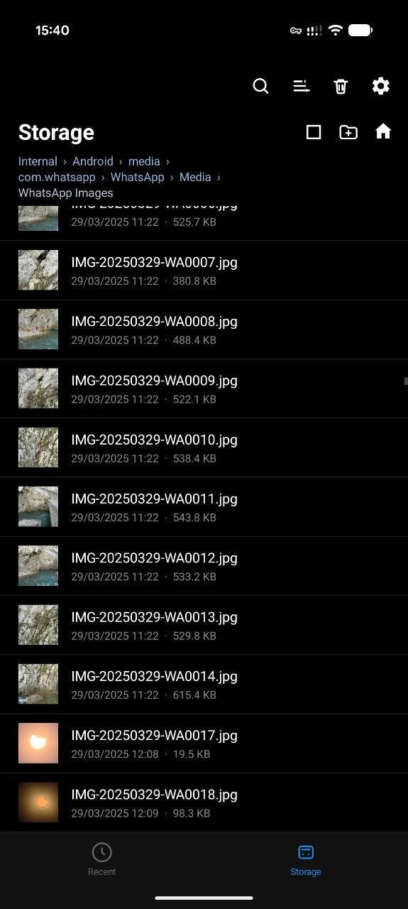
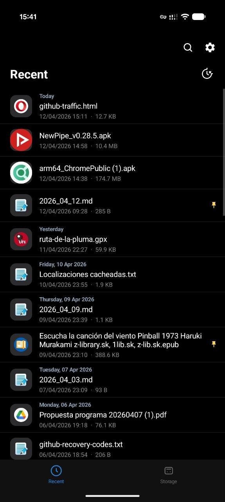
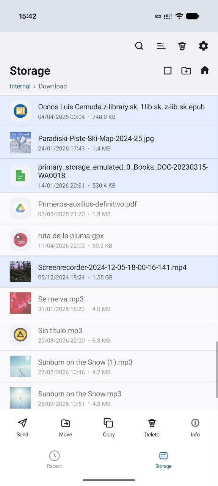
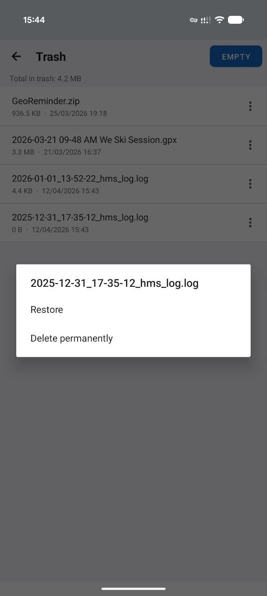
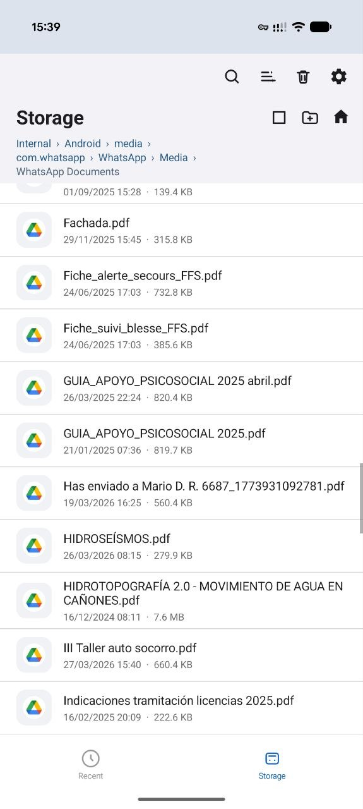
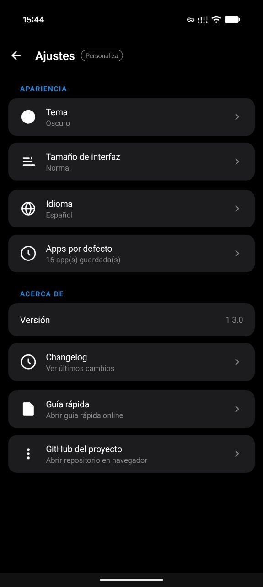
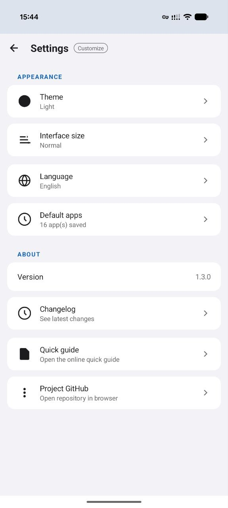

# FileManager

> A clean, lightweight Android file manager with trash support, rich previews, recent files, and bilingual UI.

[](https://github.com/fraugz/FileManager/releases/latest)
[](https://github.com/fraugz/FileManager/releases/latest)
[](LICENSE)
[](https://github.com/fraugz/FileManager/search?l=java)

---

| Language | Document |
|----------|----------|
| English  | [README.md](README.md) |
| Español  | [README.es.md](README.es.md) |

---

## Screenshots

<p align="center">
  
  
  
  
  
</p>
<p align="center">
  
  
</p>

---

## Features

- 📁 Folder navigation with breadcrumb and home shortcut
- 🕐 Recent files sorted by access date, with day separators and pin support
- ☑️ Multi-selection with copy, move, share, delete, and info actions
- 🗑️ Trash with restore and permanent delete
- 🖼️ Rich previews: image thumbnails, video frames, audio covers, APK icons
- 🔍 Incremental search with cancellation
- 📤 Share target: receive files from other apps and save to any folder
- 🎨 Appearance settings: dark/light theme, UI scale (4 sizes), language
- 🌐 Full bilingual support: English and Spanish
- 📱 Minimum Android 7.0 (API 24)

---

## Download

**[⬇️ Download latest APK](https://github.com/fraugz/FileManager/releases/latest)**

> F-Droid submission planned.

---

## Documentation

| Document | Description |
|----------|-------------|
| [Quick Guide](QUICK_GUIDE.md) | Common tasks and tips for end users |
| [Quick Guide (ES)](QUICK_GUIDE.es.md) | Tareas comunes y consejos (Spanish) |
| [Development Guide](DEVELOPMENT.md) | Architecture, behavior, changelog, testing, common issues |
| [Development Guide (ES)](DEVELOPMENT.es.md) | Same content in Spanish |

---

## Build from source

### Android Studio (recommended)

1. Clone the repository.
2. Open the project in Android Studio.
3. Wait for Gradle sync to complete.
4. Run on a device or emulator (API 24+).

### Command line

> **Note:** This repository does not include Gradle wrapper (`gradlew`/`gradlew.bat`). Use a local Gradle installation or generate the wrapper files.

```bash
gradle :app:assembleDebug
```

Output: `app/build/outputs/apk/debug/app-debug.apk`

**Requirements:** Android Studio, JDK compatible with AGP, Android SDK 34.

---

## Feedback & Community

Found a bug or have an idea? There are three ways to reach out:

- 🐛 **Bug or crash** → [Open an Issue](https://github.com/fraugz/FileManager/issues) with steps to reproduce
- 💡 **Ideas or questions** → [Join the Discussions](https://github.com/fraugz/FileManager/discussions)
- 📬 **Direct contact** → [satin-speed-friday@duck.com](mailto:satin-speed-friday@duck.com)

All feedback is welcome — the project is actively maintained.

---

## Roadmap

- Migrate to Storage Access Framework for better Android 11+ compatibility
- Dual view mode: list and grid with persistent sorting
- Richer in-app previews (PDF, video, text)
- Favorites and smart collections (Downloads, Images, Documents)
- Instrumented UI tests for critical flows
- Improved accessibility: content descriptions, contrast, keyboard navigation

---

## Versions & changelog
- **v1.3.6** — App no longer appears in "Open with…" for arbitrary file types (only shares and file-picker intents remain). Selection count label above the action bar. "Select all" and "Select by day" buttons in the Recent tab; select-all toggles (second tap deselects, check icon when all selected). Folder context menu now has "Add shortcut to home screen". Update dialog has three choices: Download APK, Remind me later, Dismiss update. APK update download uses DownloadManager for a direct in-app download with automatic installer launch on completion.
- **v1.3.5** — Recents now auto-discovers files created or downloaded by other apps (WhatsApp, camera, browser, Telegram, etc.) via a single MediaStore query — no hardcoded paths. Pull-to-refresh in Recents forces an immediate scan. Returning to Recents after 30+ seconds also triggers a fresh scan. Fixed thumbnail cache (was 20 KB cap — smaller than one thumbnail). Fixed discovery loop that required multiple taps to open a file. Fixed pull-to-refresh on empty folders (SwipeRefreshLayout was hidden).
- **v1.3.4** — App now appears in "Open with…" from other apps; opened file is registered in Recents and the browser navigates to its parent folder. App now appears as a file picker when other apps request an attachment or upload. Recents no longer auto-discovers or MediaStore-scans files; only manually opened or pinned items appear. Re-opening a file already in Recents keeps its position stable without promoting it to the top.
- **v1.3.3** — System trash now detected via MediaStore query (same as Google Photos), fixing missing Trash items. Folder item counts include both system and app trash. Only pinned folders appear in Recents automatically. Trash icon visible in both Storage and Recents tabs. New once-a-day update checker dialog.- **v1.3.2** — Critical fix: files now move to app trash instead of being deleted directly. Multi-selection also fixed. Multi-selection support added to Trash screen. Trash thumbnails use original filename for media detection. Visited folders now appear in Recents.
- **v1.3.1** — Trash screen redesigned with rich thumbnails, tap to open, long-press action bar, always-visible sections, info badge, combined empty confirmation, auto-delete countdown, and delete order changed.
- **v1.3.0** — Recents redesigned with selection, Locate, Pin, day separators, clear-keeping-pinned, compacted Storage header, breadcrumb full-width, folder sharing, share-text name dialog, smooth swipe.
- **v1.2.9** — Localized app name, extended Open picker, Info action for single item (including folders), Rename hidden on multi-selection, quick guide and GitHub links in Settings.
- **v1.2.8** — Smarter playlist names, Save here from share sheet, moved files removed from Recents.
- **v1.2.7** — Open/default app UX refinements and selection bar adjustments.
- **v1.2.6** — Multi-play playlists, select-all, paste label, progress bar, cancel long ops, delete-forever confirmation.
- **v1.2.5** — Default app direct action, searchable app picker, rich previews (audio/video/APK), APK install warning.
- **v1.2.0–v1.2.4** — Bilingual UI, language selector, stability fixes and incremental UX improvements.
- **v1.1.0** — Branding and package rename.
- **v1.0.0** — Initial baseline.

---

## Contributing

- Open an issue with context and reproduction steps
- One branch per feature or fix
- Small, focused commits
- Include screenshots for visual changes
- Describe how you validated changes before opening a PR

For technical details and development information, see **[DEVELOPMENT.md](DEVELOPMENT.md)**.

---

## License

Distributed under the MIT License. See [LICENSE](LICENSE) for details.

